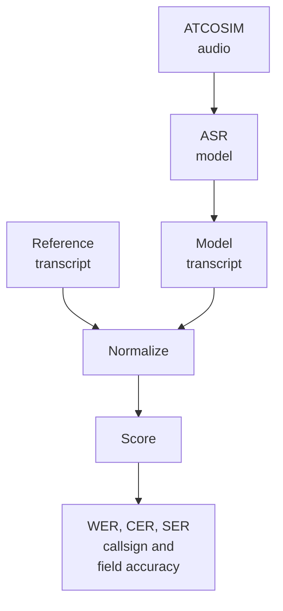

# STT-model-evaluation-in-ATC

This project provides a reproducible pipeline that evaluates Automatic Speech Recognition (ASR) models on Air Traffic Control (ATC) audio. The purpose of this study is to evaluate if general-purpose ASR models work on ATC speech, and if models fine-tuned on ATC data do better. The pipeline measures accuracy using WER, CER, SER, per-field accuracy, 95% confidence intervals, and callsign accuracy.
Eight models were evaluated. Four are general-purpose models from three major model families: OpenAI Whisper (medium and medium.en), Vosk (Alpha Cephei) and wav2vec2 (Meta/Facebook). The other four are Whisper and wav2vec2 that were fine-tuned on ATC data. General Whisper was also run a second way, as a matched baseline, so there are nine results.

### General Purpose models

Whisper:
I started with the base model before upgrading to Whisper medium, for high accuracy, especially on digits. Whisper medium was slower than the base model but was the strongest general-purpose model in this domain.

Whisper medium.en:
I added the English only version of Whisper medium as the matched baseline for the jacktol model, which was fine-tuned from it.

Vosk:
I selected the standard en‑us‑0.22 model. A larger model was attempted but required significantly more storage. Vosk is a traditional Kaldi-style recognizer, which makes it a useful baseline. It had the highest error rate of all the models.

Wav2vec2:
I first used the base 960h model, which was pretrained on unlabeled audio (audio without text) and then trained on 960 hours of labeled speech. It performed poorly on ATC audio, so I replaced it with the larger wav2vec2-large-960h-lv60-self, which did better on every metric. It is a good baseline for CTC-style ASR.

### ATC fine-tuned models

| model | base model | fine-tuned on |
|---|---|---|
| `Jzuluaga/wav2vec2-large-960h-lv60-self-en-atc-uwb-atcc` | wav2vec2 large 960h lv60 self | UWB-ATCC |
| `Jzuluaga/wav2vec2-xls-r-300m-en-atc-uwb-atcc` | wav2vec2 XLS-R 300m | UWB-ATCC |
| `jlvdoorn/whisper-medium-atco2-asr` | Whisper medium | not documented |
| `jacktol/whisper-medium.en-fine-tuned-for-ATC` | Whisper medium.en | ATCO2 (1 hour) + UWB-ATCC |

Three of these are direct comparisons with a general-purpose model because they share the same base model: wav2vec2 large vs. the Jzuluaga wav2vec2 large model, Whisper medium.en vs. jacktol, and Whisper medium vs. the jlvdoorn model. None of the documented training data includes ATCOSIM.

Jlvdoorn's training data is unknown. so its train-split results are flagged.

### Matched comparisons

Three fine-tuned models are compared directly with the general models they were built from. The general models were run through exactly the same program and settings as the fine tuned models, to make a fair comparison, so the only difference is the fine-tuning.

| general model (before) | fine-tuned model (after) | how both are run |
|---|---|---|
| `facebook/wav2vec2-large-960h-lv60-self` | Jzuluaga wav2vec2 large + ATC | `transformers`, CTC, greedy |
| `openai/whisper-medium` | jlvdoorn Whisper medium + ATC | `transformers` `generate()`, greedy, fp32, no timestamps |
| `openai/whisper-medium.en` | jacktol Whisper medium.en + ATC | `transformers` `generate()`, greedy, fp32, no timestamps |

General Whisper medium was also run with the `openai-whisper` package's `transcribe()` (timestamps on, silence skipping, fp16 on GPU). Those results are reported too, but that run is not used for the matched comparison.

### Model versions

| model | exact version |
|---|---|
| Whisper medium (openai-whisper run) | `openai-whisper` 20250625, checkpoint `medium.pt` (SHA-256 `345ae4da62f9b3d59415adc60127b97c714f32e89e936602e85993674d08dcb1`) |
| wav2vec2 large | `facebook/wav2vec2-large-960h-lv60-self` @ `54074b1c16f4de6a5ad59affb4caa8f2ea03a119` * |
| Vosk | `vosk-model-en-us-0.22`, `vosk` 0.3.45 |
| wav2vec2 large + ATC | `Jzuluaga/wav2vec2-large-960h-lv60-self-en-atc-uwb-atcc` @ `3f0dd746694354daed519e3222c01a5a372e1971` * |
| XLS-R + ATC | `Jzuluaga/wav2vec2-xls-r-300m-en-atc-uwb-atcc` @ `c0e82ce218cbae68e0bbfda4e37aee3e3208e739` |
| Whisper medium + ATC | `jlvdoorn/whisper-medium-atco2-asr` @ `cc64900035735a406b6677a82e16b2a2e1f4a06c` |
| Whisper medium.en + ATC | `jacktol/whisper-medium.en-fine-tuned-for-ATC` @ `d373acbfa93d0a69f679d0dbe121177e0874b779` |
| Whisper medium (`transformers` run) | `openai/whisper-medium` @ `abdf7c39ab9d0397620ccaea8974cc764cd0953e` |
| Whisper medium.en (`transformers` run) | `openai/whisper-medium.en` @ `2e98eb6279edf5095af0c8dedb36bdec0acd172b` |
| dataset | `Jzuluaga/atcosim_corpus` @ `7d09ef7987036af7b3c83a9375e4ee030891c616` |

\* These two repositories store their weights only in the older `.bin` format, so `transformers` also downloaded a `.safetensors` copy of the same weights from the repository's conversion pull request: `refs/pr/5` @ `bdb144224e9bb4a242a52f223186f120f6589a6b` for wav2vec2 large, and `refs/pr/2` @ `2361b204331894ef711279f1eaaa94e2972d394b` for wav2vec2 large + ATC.

Software: Python 3.13.6, torch 2.6.0+cu124, transformers 5.12.1, datasets 4.5.0, huggingface_hub 1.21.0, jiwer 4.0.0, pandas 2.3.1.

The Whisper and Wav2vec2 models use greedy decoding (Whisper: temperature 0) with no added language model. Vosk uses its own built-in search and language model, which can't be turned off.

### Data
The data comes from Hugging Face: atcosim_corpus by Jzuluaga, a version of the ATCOSIM corpus. ATCOSIM was recorded during ATC simulations with headset microphones. It contains about ten hours of English speech from ten non-native English speakers (6 male, 4 female) from three control centres, with transcriptions and segment durations.

ATCOSIM has no official train/test split. The split used here is from Zuluaga's Hugging Face version, which is also the split used for the published results on the Jzuluaga model cards.

| split | utterances | speakers | recording sessions |
|---|---|---|---|
| Zuluaga's test split (main results) | 1,901 | 4 (one man, three women) | 10 |
| Zuluaga's train split (reported separately) | 7,638 | all 10 | 41 |

The four test speakers also appear in the train split, so the two splits share speakers. The audio is not preprocessed.

Language detection was explored but dropped, because all ATCOSIM speech is in English.

### Normalization rules

The reference and the model output go through the same rules, for every model. No model output is ever corrected by hand.

1. Lowercase; remove punctuation and thousands separators (`12,000` → `12000`).
2. A decimal point becomes the word *decimal* (`125.75` → `125 decimal 75`).
3. Letters are split from digits in both directions and numbers become words (`FL270` → `FL 270` → `FL two hundred seventy`).
4. `fl` → `flight level`; ICAO spellings: `alpha` → `alfa`, `juliet` → `juliett`.
5. *triple three* → *three three three*; *double seven* → *seven seven*.
6. Numbers are compared by value and written digit by digit, so *three hundred fifty*, *three five zero* and *350* all become *three five zero*. *Tree*, *fife* and *niner* count as 3, 5 and 9.

A second, name-normalised score also joins words that ATCOSIM writes as two but models usually write as one (trans avia → transavia, speed bird → speedbird, good bye → goodbye, and 10 more airline names). It is applied to the reference and the model output for every model. The standard score is the main result.

**Callsigns:** A callsign is an airline name followed by a number (lufthansa one two three)> The airline names were collected from the reference transcripts, and the list is the same for every model. Callsign digits checks that the number is exactly right; callsign full also requires the airline name to be spelled exactly as the reference. 

### Results: Zuluaga's test split (main results)

| model | type | WER (95% CI) | WER (name-normalised) | callsign digits | callsign full | empty outputs |
|---|---|---|---|---|---|---|
| jacktol Whisper medium.en + ATC | fine-tuned | **0.1244** (0.111–0.138) | 0.1255 | **98.5%** | **63.1%** | 1 |
| Jzuluaga wav2vec2 large + ATC | fine-tuned | 0.1525 (0.141–0.164) | 0.1532 | 93.8% | 50.1% | 1 |
| jlvdoorn Whisper medium + ATC | fine-tuned | 0.1529 (0.140–0.165) | 0.1522 | 95.7% | 50.9% | 0 |
| Whisper medium (`transformers`, matched) | general | 0.1917 (0.181–0.201) | 0.1766 | 93.2% | 47.9% | 0 |
| Jzuluaga XLS-R + ATC | fine-tuned | 0.1918 (0.174–0.208) | 0.1941 | 92.2% | 43.8% | 2 |
| Whisper medium (`openai-whisper`) | general | 0.1961 (0.183–0.208) | 0.1809 | 93.0% | 46.7% | 4 |
| Whisper medium.en (`transformers`, matched) | general | 0.2219 (0.203–0.238) | 0.2077 | 87.7% | 44.3% | 0 |
| wav2vec2 large | general | 0.4072 (0.376–0.440) | 0.4010 | 71.6% | 7.1% | 1 |
| Vosk | general | 0.4466 (0.422–0.474) | 0.4436 | 46.0% | 15.5% | 0 |

1,901 utterances, 22,709 reference words, 1,545 utterances with a callsign. The 95% confidence intervals come from 5,000 bootstrap resamples of whole recording sessions. *Empty outputs* = utterances where the model returned no text.

**Field accuracy (% of values recognised), test split**

| model | frequency | flight level | heading | squawk | left/right |
|---|---|---|---|---|---|
| jacktol + ATC | 100.0 | 99.8 | 100.0 | 100.0 | 99.1 |
| Jzuluaga wav2vec2 + ATC | 98.4 | 100.0 | 100.0 | 100.0 | 99.1 |
| jlvdoorn + ATC | 97.9 | 100.0 | 100.0 | 100.0 | 99.1 |
| Whisper medium (matched) | 86.0 | 98.6 | 98.4 | 99.3 | 98.1 |
| Jzuluaga XLS-R + ATC | 95.3 | 99.6 | 100.0 | 100.0 | 95.3 |
| Whisper medium (`openai-whisper`) | 86.0 | 98.6 | 95.2 | 98.5 | 96.3 |
| Whisper medium.en (matched) | 86.0 | 97.2 | 95.2 | 92.0 | 94.4 |
| wav2vec2 large | 50.3 | 84.0 | 90.3 | 98.5 | 68.2 |
| Vosk | 22.8 | 62.8 | 61.3 | 88.3 | 75.7 |
| *n* | 193 | 500 | 62 | 137 | 107 |

### Results: Zuluaga's train split (reported separately)

| model | type | WER (95% CI) | WER (name-normalised) | callsign digits | callsign full | empty outputs |
|---|---|---|---|---|---|---|
| jacktol Whisper medium.en + ATC | fine-tuned | **0.1376** (0.127–0.149) | 0.1381 | **98.1%** | **53.6%** | 0 |
| jlvdoorn Whisper medium + ATC ⚑ | fine-tuned | 0.1612 (0.153–0.170) | 0.1569 | 96.9% | 46.3% | 0 |
| Jzuluaga wav2vec2 large + ATC | fine-tuned | 0.1764 (0.166–0.188) | 0.1750 | 92.4% | 40.2% | 2 |
| Jzuluaga XLS-R + ATC | fine-tuned | 0.2187 (0.206–0.232) | 0.2184 | 90.8% | 35.2% | 4 |
| Whisper medium (`transformers`, matched) | general | 0.2218 (0.209–0.236) | 0.2074 | 91.9% | 40.2% | 1 |
| Whisper medium (`openai-whisper`) | general | 0.2235 (0.211–0.237) | 0.2092 | 91.7% | 39.0% | 8 |
| Whisper medium.en (`transformers`, matched) | general | 0.2258 (0.209–0.244) | 0.2107 | 90.4% | 40.1% | 0 |
| wav2vec2 large | general | 0.4298 (0.414–0.445) | 0.4252 | 69.8% | 8.2% | 13 |
| Vosk | general | 0.5198 (0.494–0.548) | 0.5187 | 42.0% | 16.6% | 12 |

7,638 utterances, 84,881 reference words, 6,252 utterances with a callsign. ⚑ jlvdoorn's training data is undocumented, so exposure to ATCOSIM's train split can't be ruled out.

### Matched comparisons: relative WER reduction from fine-tuning

| general → fine-tuned | test split (95% CI) | test, name-normalised | train split (95% CI) |
|---|---|---|---|
| wav2vec2 large → Jzuluaga wav2vec2 + ATC | **62.5%** (59.8–64.8%) | 61.8% | 59.0% (57.0–60.8%) |
| Whisper medium → jlvdoorn | **20.2%** (17.2–24.0%) | 13.8% | 27.3% (24.5–30.0%) ⚑ |
| Whisper medium.en → jacktol | **44.0%** (38.5–49.3%) | 39.6% | 39.1% (36.7–41.3%) |

### Findings

- **Fine-tuning helps.** With the same base model and the same program,, ATC fine-tuning cut WER by 62.5% for wav2vec2, 20.2% for Whisper medium, and 44.0% for Whisper medium.en on the test split. The train split also shows the same trend for all three pairs.
- **Part of Whisper's gain is spelling style, not recognition.** When spelling differences such as *good by* and *goodbye* are normalized, the Whisper medium gain falls from 20.2% to 13.8%. Fine-tuning taught the model some of ATCOSIM's transcription conventions.
- **How Whisper is run makes only a small difference.** The same general WHisper medium scored 19.61% WER with 'openai-whisper' and 19.17% with 'transformers' on the test split, and 22.35% vs 22.18% on the train split (a tie). The 'openai-whisper' run also returned more empty outputs (4 on test, 8 on train) than the 'transformers' run (0 and 1), most likelyu because of its silence skipping.
- **Fine-tuned models get the numbers right.** They recognise at least 95.3% of frequencies on the test split (98.0% on train), against 86.0% for every general Whisper run. They also recognize at least 99.6% on flight levels and 100% on headings and squawk codes.No model ever swapped *left* and *right*.
-**Callsign numbers do not separate the two groups.** General Whisper medium gets 93.0%-93.2% of call sign numbers right on the test split, about the same amount as the fine-tuned wav2vec models (92.2-93.8%). Only fine-tuned Whisper models are higher (95.7-98.5%). Requiring airline names to be spelled right lowers each model to 63% or below, mostly because airline names are misheard or misspelled; when just checking numbers, an error like *sabena*  → *siberia* still counts as correct.
- **Some differences in the ranking are not meaningful.** On the test split, Jzuluaga wav2vec2 + ATC and jlvdoorn are tied (15.25% vs 15.29%). Jzuluaga XLS-R + ATC and general Whisper medium are tied on both splits.
- **The setup matches published results.** The Jzuluaga wav2vec2 model scores 15.25% WER here; its model card reports 15.31% (no language model) on the same test split.
- **jlvdoorn behaves differently from the documented models.** From test to train, the wav2vec2 and jacktol gains shrink (62.5% → 59.0% and 44.0% → 39.1%), while jlvdoorn's grows (20.2% → 27.3%). That is consistent with, but does not prove, exposure to ATCOSIM training data, so its train results stay flagged and the test split is the main result.
- **The setup matches published results.** The Jzuluaga wav2vec2 model scores 15.25% WER here; its model card reports 15.31% on the same test split.
  
### Representative errors

Most frequent word substitutions on the test split(reference → model output):

| model | examples | pattern |
|---|---|---|
| Vosk | two → to (387), four → for (210) | numbers written as everyday words |
| wav2vec2 large | descend → descent (53), flight → flat (52) | spelled by sound |
| Whisper medium (openai-whisper) | lufthansa → lofthansa (77), good → goodbye (135) | misspelled airline; ATCOSIM spelling style |
| wav2vec2 large + ATC | geneva → jneva (19), squawk → squak (22) | spelled by sound |
| jlvdoorn + ATC | rhein → ryan (85), trasadingen → in (36) | unfamiliar place names replaced by known words |
| jacktol + ATC | sabena → siberia (30), reims → rhein (42) | unfamiliar names replaced by known words |

The general models confuse numbers with everyday words; the fine-tuned models almost never do. Most of their remaining errors are place and airline names from the airspace ATCOSIM was recorded in.
### Pipeline

The pipeline loads speech samples from the ATCOSIM corpus and transcribes each one with every model. Each transcription has a 'Split' setting ('"test"' or '"train"'). Each model's raw output is saved to a CSV file in  `transcripts/` (test split) or `transcripts_train/` (train split), and all scoring is done afterwards from those files. Every model is scored by exactly the same rules. 

- `rescore_test.py` / `rescore_train.py`: WER, CER, SER and callsign accuracy
- `error_analysis_test.py` / `error_analysis_train.py`: field accuracy and most frequent errors
- `confidence_intervals_test.py` / `confidence_intervals_train.py`: 95% bootstrap confidence intervals, resampling utterances and whole recording sessions, paired across models

Both the reference transcript and the model output are normalized (see above) before comparison. WER and CER are calculated over the whole test split (total errors ÷ total reference words), not averaged per sample.

### Limitations

- **One corpus.** ATCOSIM is clean simulation audio recorded with headset microphones, so results may not carry over to real, noisier radio audio.
- **Four test speakers.** The test split covers 4 of the 10 speakers and only 10 recording sessions, so the session-level confidence intervals are approximate.
- **One fine-tuned model's training data is undocumented** (`jlvdoorn/whisper-medium-atco2-asr`).
- **Callsign coverage.** Callsigns are found in about 81% of utterances. Letter-only registrations and a small number of utterances (under 2%) whose airline name couldn't be identified are not counted.

The scorer was last updated on Nov 1, 2026 to read altitudes written without a space (`4000ft`) and to recognise the airline US Air; this mainly changed the general Whisper results.

Earlier versions of this README reported different numbers (e.g. Whisper medium WER 0.453) and a sentence-similarity score (STS). Those came from an older scoring script with bugs in its number handling and are not comparable with the results above.

