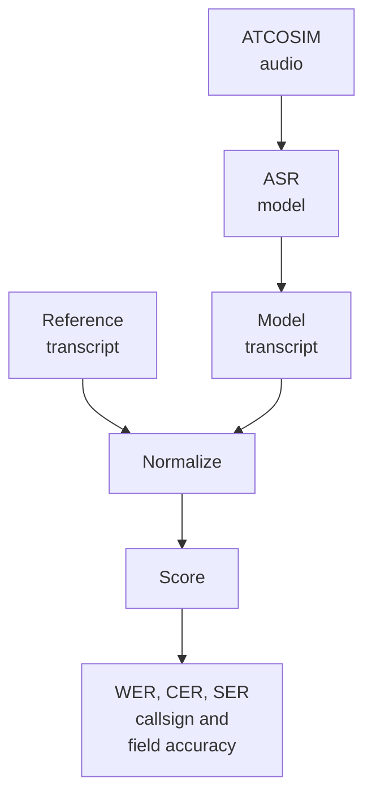

# STT-model-evaluation-in-ATC

This project provides a reproducible pipeline that evaluates Automatic Speech Recognition (ASR) models on Air Traffic Control (ATC) audio. The purpose of this study is to evaluate if general-purpose ASR models work on ATC speech, and if models fine-tuned on ATC data do better. The pipeline measures accuracy using WER, CER, SER and callsign accuracy.
Seven models were evaluated. Three are general-purpose models from three major model families: OpenAI Whisper, Vosk (Alpha Cephei) and wav2vec2 (Meta/Facebook). The other four are Whisper and wav2vec2 models that were fine-tuned on ATC data.

### General Purpose models

Whisper:
I started with the base model before upgrading to Whisper medium, for high accuracy, especially on digits. Additionally, Whisper medium was slower than the base model but was the strongest of the three general-purpose models in this domain.

Vosk:
I selected the standard en‑us‑0.22 model. A larger model was attempted but required significantly more storage. Vosk is a traditional Kaldi-style recognizer, which makes it a useful baseline. It had the highest error rate of the seven models.

Wav2vec:
I first used the base 960h model, which was pretrained on unlabeled audio (audio without text) and then trained on 960 hours of labeled speech. It performed poorly on ATC audio, so I replaced it with the larger wav2vec2-large-960h-lv60-self, which did better on every metric. It is a good baseline for CTC-style ASR.

### ATC fine-tuned models

| model | base model | fine-tuned on |
|---|---|---|
| `Jzuluaga/wav2vec2-large-960h-lv60-self-en-atc-uwb-atcc` | wav2vec2 large 960h lv60 self | UWB-ATCC |
| `Jzuluaga/wav2vec2-xls-r-300m-en-atc-uwb-atcc` | wav2vec2 XLS-R 300m | UWB-ATCC |
| `jlvdoorn/whisper-medium-atco2-asr` | Whisper medium | not documented |
| `jacktol/whisper-medium.en-fine-tuned-for-ATC` | Whisper medium.en | ATCO2 (1 hour) + UWB-ATCC |

Two of these are direct comparisons with a general-purpose model because they share the same base model: wav2vec2 large vs. the Jzuluaga wav2vec2 large model, and Whisper medium vs. the jlvdoorn model. None of the documented training data includes ATCOSIM.

### Model versions

| model | exact version |
|---|---|
| Whisper medium | `openai-whisper` 20250625, checkpoint `medium.pt` (SHA-256 `345ae4da62f9b3d59415adc60127b97c714f32e89e936602e85993674d08dcb1`) |
| wav2vec2 large | `facebook/wav2vec2-large-960h-lv60-self` @ `54074b1c16f4de6a5ad59affb4caa8f2ea03a119` * |
| Vosk | `vosk-model-en-us-0.22`, `vosk` 0.3.45 |
| wav2vec2 large + ATC | `Jzuluaga/wav2vec2-large-960h-lv60-self-en-atc-uwb-atcc` @ `3f0dd746694354daed519e3222c01a5a372e1971` * |
| XLS-R + ATC | `Jzuluaga/wav2vec2-xls-r-300m-en-atc-uwb-atcc` @ `c0e82ce218cbae68e0bbfda4e37aee3e3208e739` |
| Whisper medium + ATC | `jlvdoorn/whisper-medium-atco2-asr` @ `cc64900035735a406b6677a82e16b2a2e1f4a06c` |
| Whisper medium.en + ATC | `jacktol/whisper-medium.en-fine-tuned-for-ATC` @ `d373acbfa93d0a69f679d0dbe121177e0874b779` |
| dataset | `Jzuluaga/atcosim_corpus` @ `7d09ef7987036af7b3c83a9375e4ee030891c616` |

\* These two repositories store their weights only in the older `.bin` format, so `transformers` also downloaded a `.safetensors` copy of the same weights from the repository's conversion pull request: `refs/pr/5` @ `bdb144224e9bb4a242a52f223186f120f6589a6b` for wav2vec2 large, and `refs/pr/2` @ `2361b204331894ef711279f1eaaa94e2972d394b` for wav2vec2 large + ATC.

Software: Python 3.13.6, torch 2.6.0+cu124, transformers 5.12.1, datasets 4.5.0, huggingface_hub 1.21.0, jiwer 4.0.0, pandas 2.3.1.

The Whisper and wav2vec models use greedy decoding (Whisper: temperature 0) with no added language model. Vosk uses its own built-in search and language model, which can't be turned off.

### Data
The data comes from Hugging Face: atcosim_corpus by Jzuluaga, a version of the ATCOSIM corpus. ATCOSIM was recorded during ATC simulations with headset microphones. It contains about ten hours of English speech from ten non-native English speakers (6 male, 4 female) from three control centres, with transcriptions and segment durations.

Results below use the official test split (1,901 utterances). The test split contains only 4 of the 10 speakers (one man and three women); the train split contains all 10. The audio is not preprocessed.

Language detection was explored but dropped, because all ATCOSIM speech is in English.

### Normalization rules

The reference and the model output go through the same rules, for every model. No model output is ever corrected by hand.

1. Lowercase; remove punctuation and thousands separators (`12,000` → `12000`).
2. A decimal point becomes the word *decimal* (`125.75` → `125 decimal 75`).
3. Letters are split from digits and numbers become words (`FL270` → `FL 270` → `FL two hundred seventy`).
4. `fl` → `flight level`; ICAO spellings: `alpha` → `alfa`, `juliet` → `juliett`.
5. *triple three* → *three three three*; *double seven* → *seven seven*.
6. Numbers are compared by value and written digit by digit, so *three hundred fifty*, *three five zero* and *350* all become *three five zero*. *Tree*, *fife* and *niner* count as 3, 5 and 9.

A second, name-normalised score also joins words that ATCOSIM writes as two but models usually write as one (trans avia → transavia, speed bird → speedbird, good bye → goodbye, and 10 more airline names). It is applied to the reference and the model output for every model. The standard score is the main result.

### Results

| model | type | WER | WER (name-normalised) | callsign accuracy |
|---|---|---|---|---|
| jacktol Whisper medium.en + ATC | fine-tuned | **0.1244** | 0.1255 | **98.5%** |
| Jzuluaga wav2vec2 large + ATC | fine-tuned | 0.1525 | 0.1532 | 93.8% |
| jlvdoorn Whisper medium + ATC | fine-tuned | 0.1529 | 0.1522 | 95.8% |
| Jzuluaga XLS-R + ATC | fine-tuned | 0.1918 | 0.1941 | 92.1% |
| Whisper medium | general | 0.2004 | 0.1852 | 90.5% |
| wav2vec2 large | general | 0.4072 | 0.4010 | 71.8% |
| Vosk | general | 0.4466 | 0.4436 | 46.3% |

Callsign accuracy is the share of callsigns whose number the model got exactly right (1,534 utterances with a callsign).

### Findings

- **Fine-tuning helps.** With the same base model, ATC fine-tuning cut WER by 62.5% for wav2vec2 and 23.7% for Whisper. This holds for each of the four test speakers.
- **Fine-tuned models get the numbers right.** They recognise at least 95% of frequencies, flight levels, headings and squawk codes. General Whisper gets 85% of frequencies. No model ever swapped *left* and *right*.
- **The setup matches published results.** The Jzuluaga wav2vec2 model scores 15.25% WER here; its model card reports 15.31% on the same test split.
  
### Representative errors

Most frequent word substitutions (reference → model output):

| model | examples | pattern |
|---|---|---|
| Vosk | two → to (387), four → for (210) | numbers written as everyday words |
| wav2vec2 large | descend → descent (53), flight → flat (52) | spelled by sound |
| Whisper medium | lufthansa → lofthansa (77), good → goodbye (135) | misspelled airline; ATCOSIM spelling style |
| wav2vec2 large + ATC | geneva → jneva (19), squawk → squak (22) | spelled by sound |
| jlvdoorn + ATC | rhein → ryan (85), trasadingen → in (36) | unfamiliar place names replaced by known words |
| jacktol + ATC | sabena → siberia (30), reims → rhein (42) | unfamiliar names replaced by known words |

The general models confuse numbers with everyday words; the fine-tuned models almost never do. Most of their remaining errors are place and airline names from the airspace ATCOSIM was recorded in.
### Pipeline

The pipeline loads speech samples from the ATCOSIM corpus and transcribes each one with every model. Each model's raw output is saved to a CSV file, and all scoring is done afterwards from those files by rescore_test.py, so every model is scored by exactly the same rules. Both the reference transcript and the model output are normalized (see above) before comparison. WER and CER are calculated over the whole test split (total errors ÷ total reference words), not averaged per sample.

Earlier versions of this README reported different numbers (e.g. Whisper medium WER 0.453) and a sentence-similarity score (STS). Those came from an older scoring script with bugs in its number handling and are not comparable with the results above.

